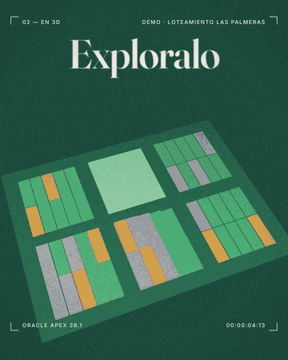
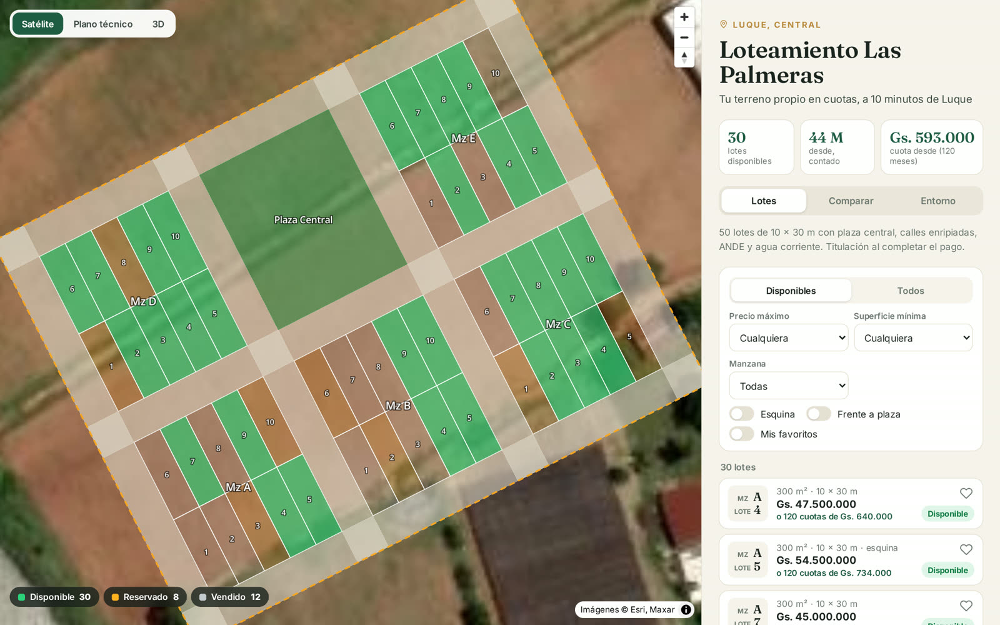
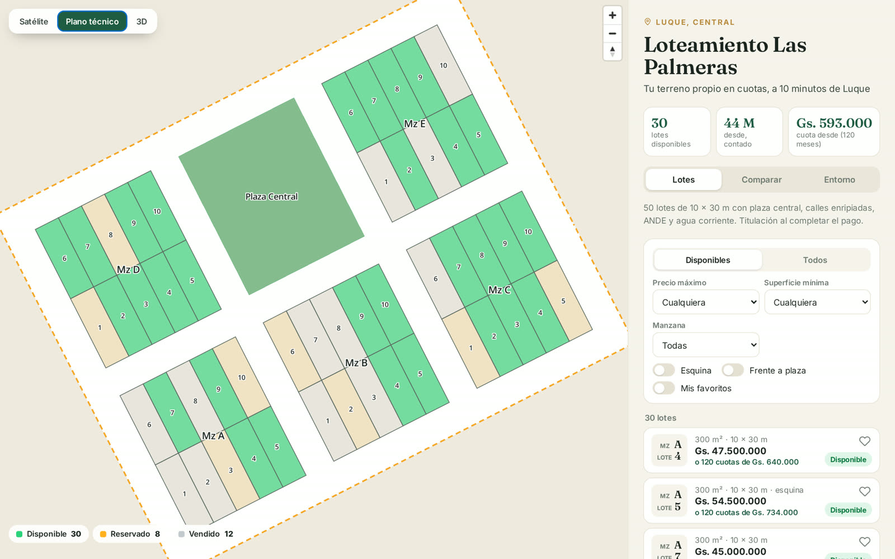
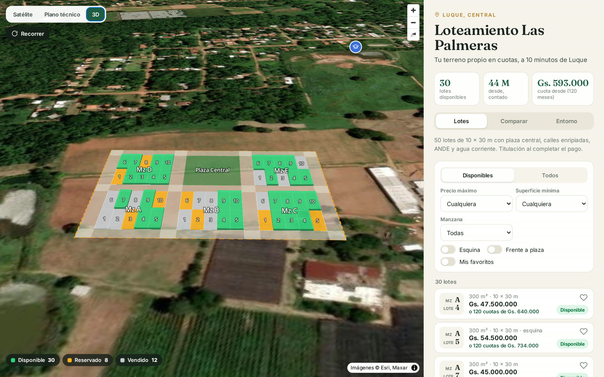
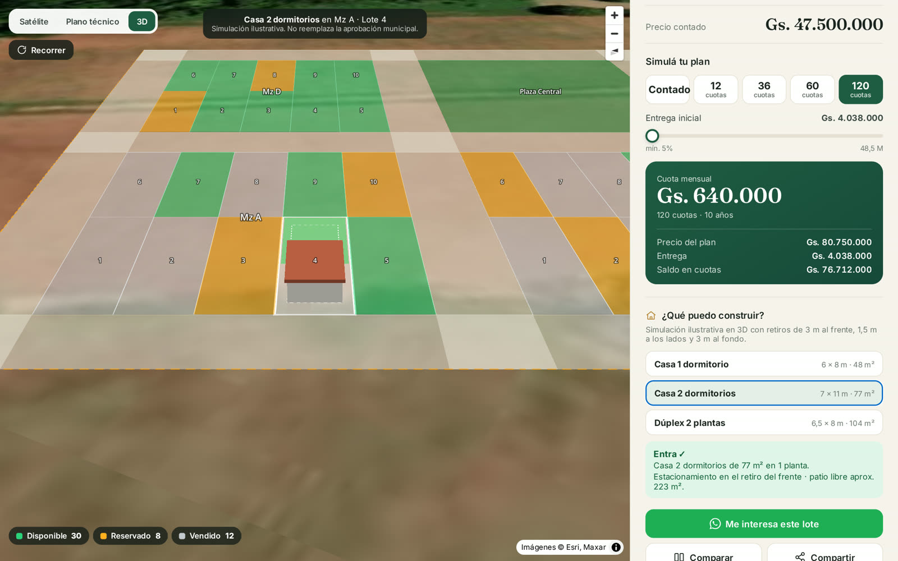
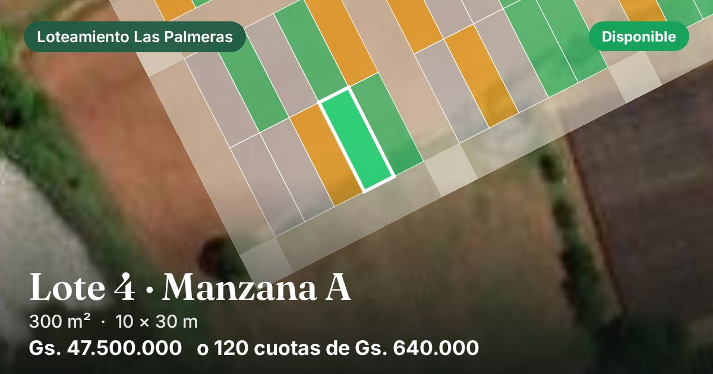

[Español](README.md) | **English**

# 3D Lot Map for Oracle APEX

**A lot-sales map your customers can explore in 3D, use to estimate their installments, and share on WhatsApp.**

If you sell lots in a subdivision, a PDF plan isn't enough. With this kit your customers:
- see every lot on satellite imagery, colored by status;
- explore it in 3D and check which house fits on the plot;
- work out the installment for each payment plan;
- share a link to the lot: on WhatsApp it shows up with a photo, size and price.

Everything runs inside your APEX app. All the code is here, explained step by step. The interface is in Spanish.

> Built on APEX with [MapLibre GL](https://maplibre.org), Esri satellite imagery and points of
> interest from [OpenStreetMap](https://www.openstreetmap.org). No paid plugins, no Google Maps key.

▶️ [Watch the full video (27 s)](video/plano-lotes-3d.mp4) · 🌐 [Try the live demo](https://g1d558790c6dc29-fernandov.adb.sa-saopaulo-1.oraclecloudapps.com/ords/r/apexfernandov/sistema-general/loteamiento)

---

## What's included

1. **Three views:** satellite, technical plan with the measurements of each side, and tilted 3D. Lots are colored by status (available, reserved, sold) and can be filtered.
2. **Lot sheet and installment simulator:** area, measurements, orientation, neighbouring lots and cash price. Choose a plan (12, 36, 60 or 120 installments, all configurable), adjust the down payment and see the monthly installment instantly. Each plan has its own surcharge, and a lot can have a special price.
3. **"What can I build?":** draws a model house in 3D inside the lot, respecting the front, side and rear setbacks, and tells you whether it fits.
4. **Comparison, favorites and surroundings:** compare up to 3 lots, save favorites in the browser, and see nearby schools, health centers, supermarkets and fuel stations with their distance.
5. **One link per lot, with a WhatsApp preview:** `…/loteamiento?lote=110` shows a card with the lot's satellite photo, status and price (Open Graph). The images are generated from the admin page with one click.
6. **Admin page for the seller:** prices, statuses, payment plans, subdivision details, sales WhatsApp number, setbacks and points of interest.

| Satellite | Technical plan | 3D |
|---|---|---|
|  |  |  |

| What can I build? | WhatsApp preview |
|---|---|
|  |  |

---

## Requirements

| Requirement | Details |
|-------------|---------|
| **Oracle APEX** | Tested on APEX 26.1. The [free cloud APEX](https://apex.oracle.com) works. |
| **Oracle Database** | The one that comes with APEX. Tested on Oracle 23ai / 26ai (Autonomous Database). |
| **Lot polygons** | Stored in the `MAP_AREA` table. Draw them with the *Croquis y áreas* module of the [APEX Map Kit](https://github.com/Fernand-v/apex-mapas-leaflet), or load them as GeoJSON. |
| **Internet access** | MapLibre GL loads from `unpkg.com` and satellite imagery from `server.arcgisonline.com`. Both are free and public. |

---

## Installation

### Step 1 - Load the database code
In **SQL Workshop > SQL Scripts** (or SQL Developer), run the files in [`sql/`](sql/) **in order**:

1. `00_requisitos.sql`: the `MAP_AREA` table (skip it if you installed the map kit's *Croquis y áreas* module).
2. `10_lotes_tablas.sql`: the subdivision tables.
3. `11_lotes_paquete.sql`: the `LOT000` package.
4. *(Optional)* `90_demo_loteamiento.sql` and `91_demo_historia_y_obras.sql`: a 50-lot demo subdivision near Luque, Paraguay.

Every file can be run again without breaking anything.

### Step 2 - Create the pages
Follow [`paginas/COMO-CREAR-LAS-PAGINAS.md`](paginas/COMO-CREAR-LAS-PAGINAS.md) (in Spanish). You create three blank pages:
- the public map, with page alias `LOTEAMIENTO`;
- the seller's admin page, behind login;
- an image page, with alias `LOT-OG`.

Before that, upload the files in [`paginas/js/`](paginas/js/) and [`paginas/css/`](paginas/css/) as *Static Application Files* under `lot/`.

### Step 3 - Draw your subdivision
Each lot is a polygon in `MAP_AREA` with:
- `ARE_TIPO = 'POLIGONO'`;
- `ARE_CATEGORIA = 'Lote'`;
- a name like `Mz A - Lote 4` (block and lot number are read from it).

Streets (`Calle`), the plaza (`Plaza`) and the boundary (`Perimetro`) are drawn as context.

---

## License

[MIT](LICENSE): use it, change it and share it freely, including in commercial projects. If it helps you, a star on the repo is appreciated.

---

*Built with Oracle APEX + MapLibre GL + OpenStreetMap. Companion to the [APEX Map Kit](https://github.com/Fernand-v/apex-mapas-leaflet).*
