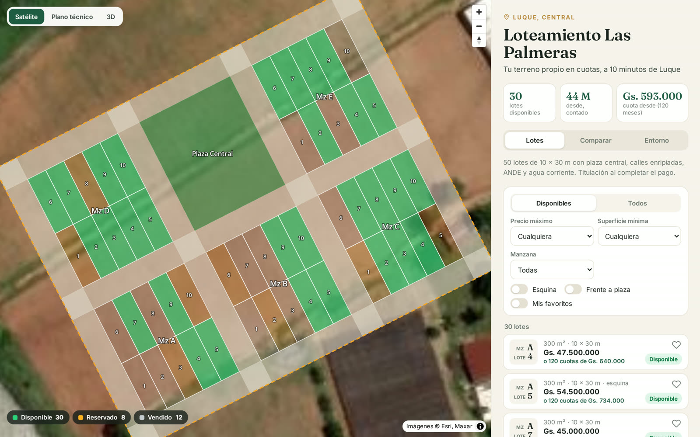
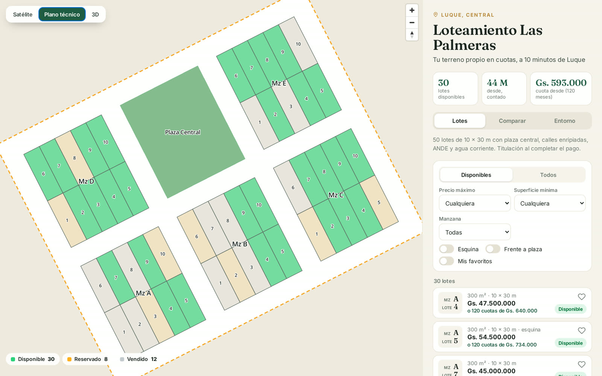
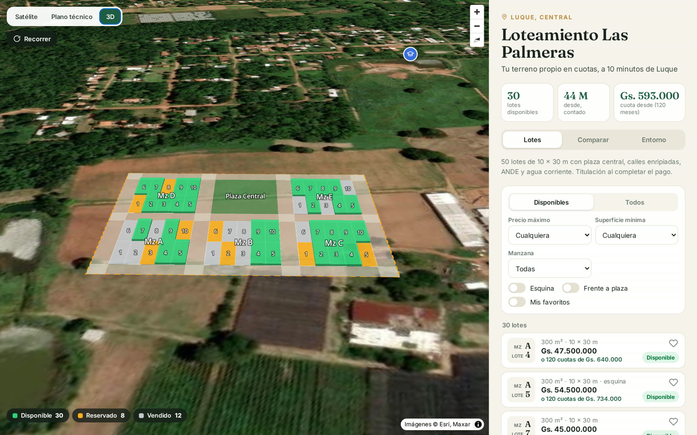
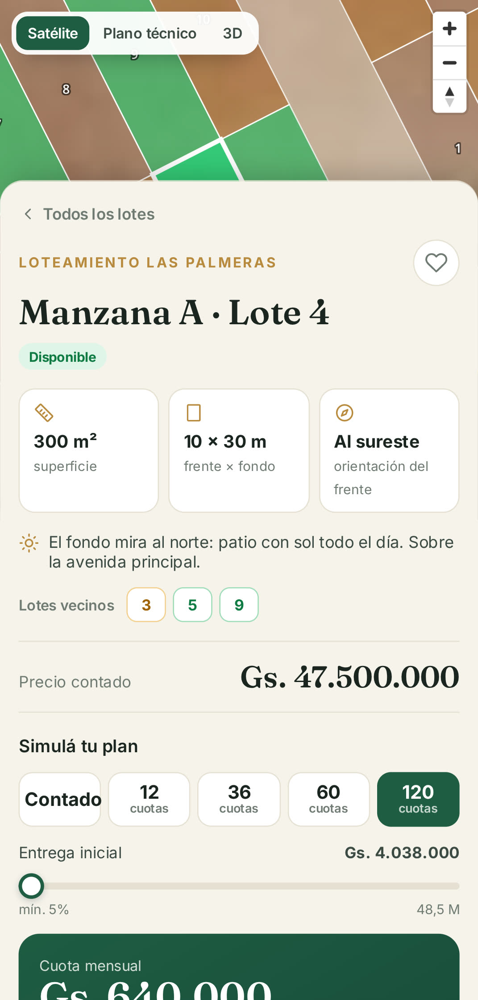
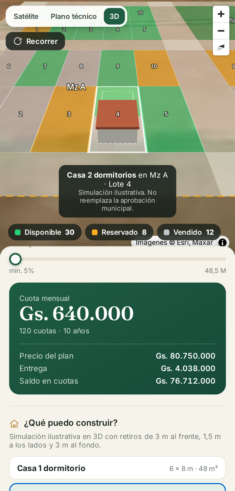
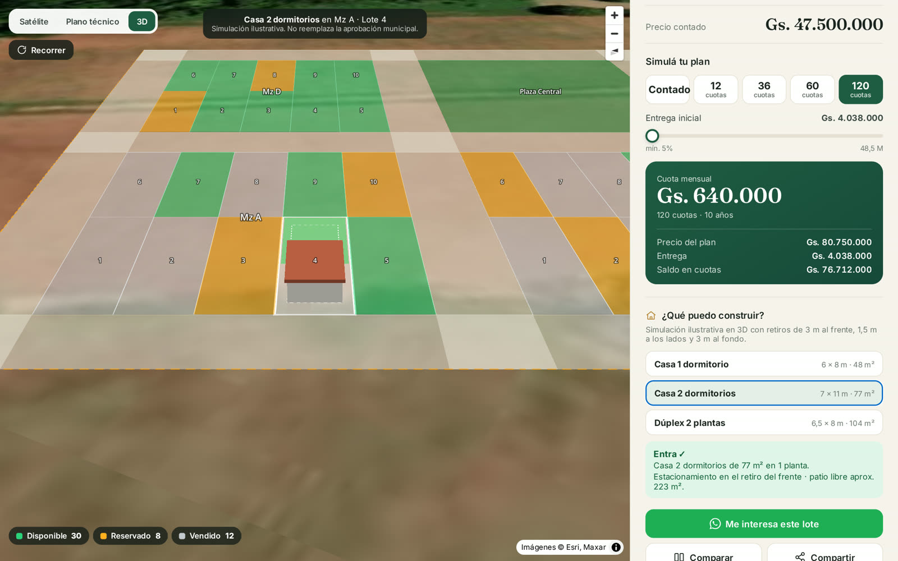
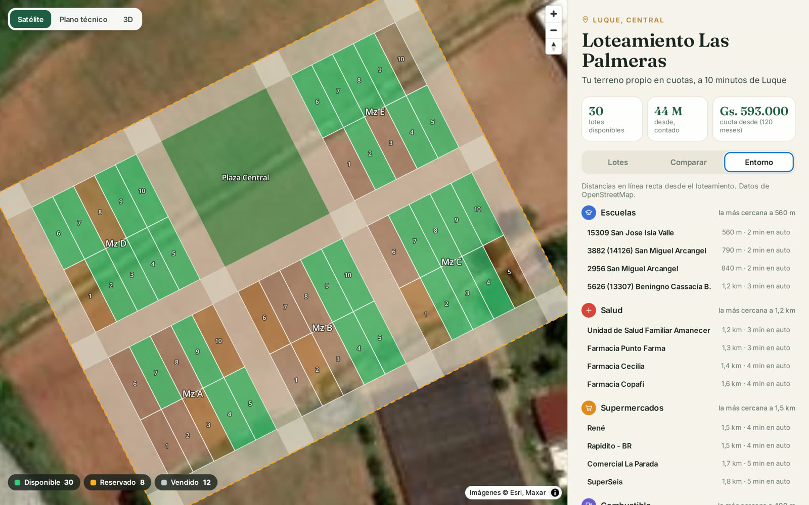
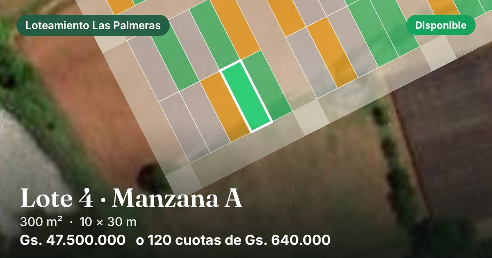
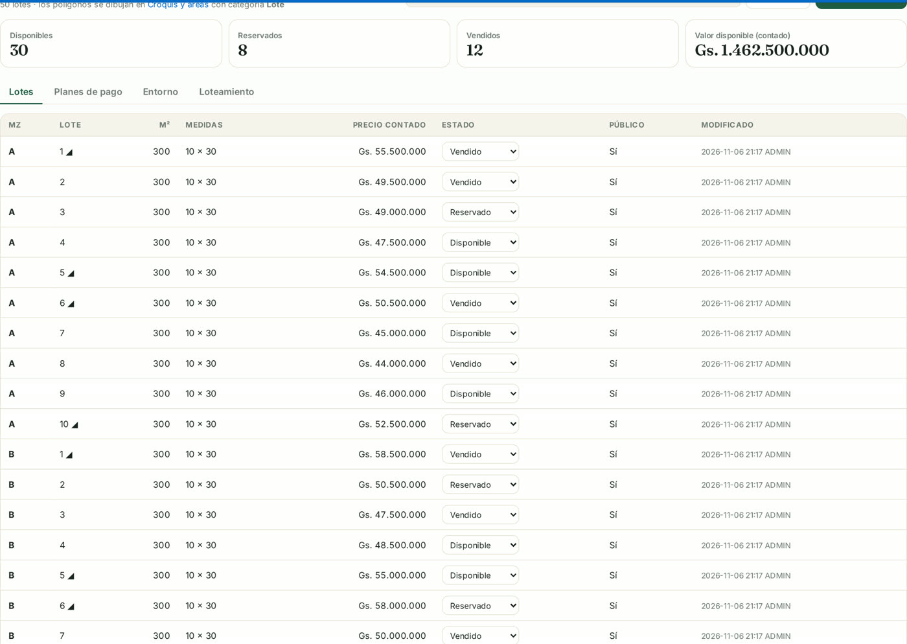
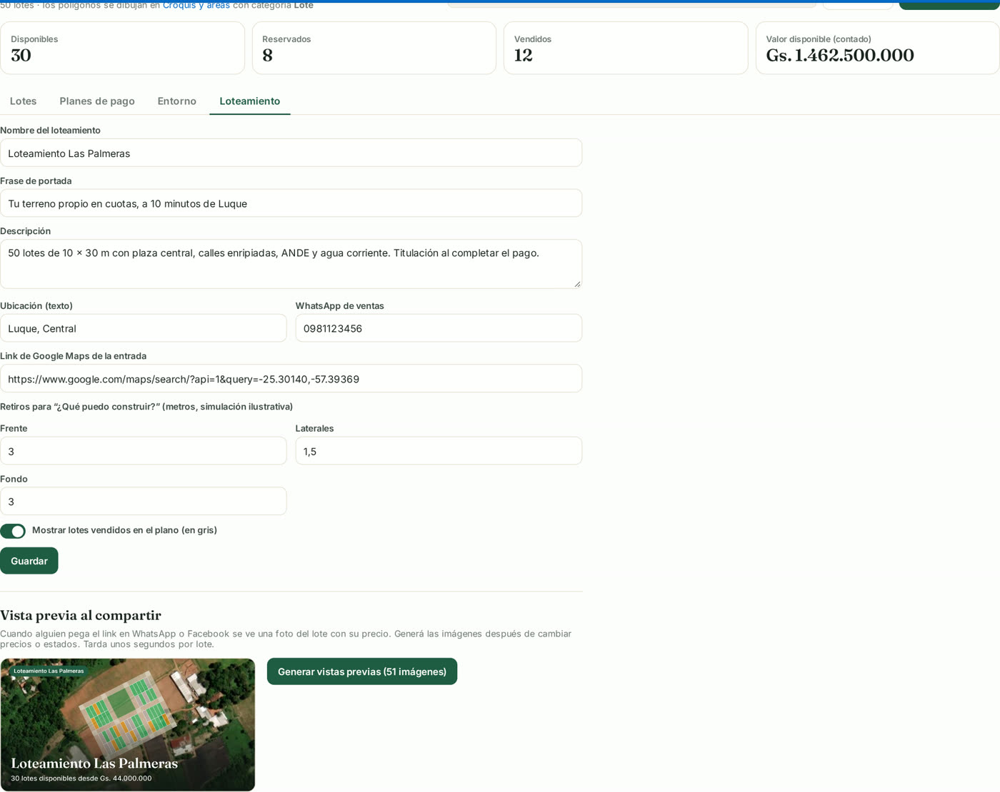

**Español** | [English](README.en.md)

# Plano de Lotes 3D para Oracle APEX

**Un plano de venta de lotes que tus clientes pueden recorrer en 3D, simular sus cuotas y compartir por WhatsApp.**

Si vendés lotes de un loteamiento, un plano en PDF no alcanza. Con este kit tus clientes:
- ven cada lote sobre la imagen satelital, con su estado;
- lo recorren en 3D y ven qué casa entra en el terreno;
- calculan la cuota de cada plan de pago;
- comparten el link del lote: en WhatsApp aparece con foto, medidas y precio.

Todo corre en tu APEX. El código está aquí, explicado paso a paso y en español.

> Hecho sobre APEX con [MapLibre GL](https://maplibre.org), la imagen satelital de Esri y los
> puntos de interés de [OpenStreetMap](https://www.openstreetmap.org). Sin plugins de pago ni
> clave de Google Maps.

▶️ [Ver el video completo (27 s)](video/plano-lotes-3d.mp4) · 🌐 [Probar la demo en vivo](https://g1d558790c6dc29-fernandov.adb.sa-saopaulo-1.oraclecloudapps.com/ords/r/apexfernandov/sistema-general/loteamiento)

---

## Qué incluye

### 1. Plano en tres vistas
Satélite, plano técnico con las medidas de cada lado, y 3D inclinado. Cada lote tiene el color de su estado: **verde** disponible, **ámbar** reservado, **gris** vendido. Se filtra por precio, superficie, manzana, esquina o frente a la plaza.

---

### 2. Ficha del lote y simulador de cuotas
Superficie, medidas, orientación del frente, lotes vecinos y precio contado. El cliente elige el plan (12, 36, 60 o 120 cuotas, configurables), mueve la entrega inicial y ve la cuota al instante. Cada plan tiene su recargo, y un lote puntual puede tener precio especial.

**Sirve para:** que el cliente sepa cuánto paga por mes sin llamar a nadie.

| Ficha | Cuotas |
|---|---|
|  |  |

---

### 3. ¿Qué puedo construir?
Dibuja en 3D una casa modelo dentro del lote respetando los **retiros** de frente, laterales y fondo, y dice si entra. Hay tres modelos: 1 dormitorio, 2 dormitorios y dúplex.

---

### 4. Comparador, favoritos y entorno
- **Comparador:** hasta 3 lotes lado a lado.
- **Favoritos:** quedan guardados en el navegador.
- **Entorno:** escuelas, salud, supermercados y combustible cercanos, con la distancia.

---

### 5. Un link por lote, con vista previa en WhatsApp
Cada lote tiene su link (`…/loteamiento?lote=110`). Al pegarlo en WhatsApp o Facebook aparece una tarjeta con la foto satelital del lote, su estado y su precio. Las imágenes se generan con un botón desde la gestión.

---

### 6. Gestión para el vendedor
Precios, estados y precio especial por plan. Planes de pago, datos del loteamiento, WhatsApp de ventas, retiros y puntos de interés: estos últimos se buscan en OpenStreetMap con un clic.

---

## Requisitos

| Requisito | Detalle |
|-----------|---------|
| **Oracle APEX** | Probado en APEX 26.1. Sirve el [APEX gratuito en la nube](https://apex.oracle.com/es/). |
| **Base de datos Oracle** | La que viene con APEX. Probado en Oracle 23ai / 26ai (Autonomous Database). |
| **Los polígonos de los lotes** | En la tabla `MAP_AREA`. Se dibujan con el módulo *Croquis y áreas* del [Kit de Mapas para APEX](https://github.com/Fernand-v/apex-mapas-leaflet), o se cargan como GeoJSON. |
| **Conexión a internet** | MapLibre GL se carga desde `unpkg.com` y la imagen satelital desde `server.arcgisonline.com`. Ambos son gratuitos y públicos. |

---

## Instalación (paso a paso)

### Paso 1 - Cargar el código en la base de datos
Abre **SQL Workshop > SQL Scripts** en tu APEX (o SQL Developer) y ejecuta, **en orden**, los archivos de la carpeta [`sql/`](sql/):

1. `00_requisitos.sql`: la tabla `MAP_AREA` (sáltalo si ya instalaste el croquis del kit de mapas).
2. `10_lotes_tablas.sql`: las tablas del loteamiento.
3. `11_lotes_paquete.sql`: el paquete `LOT000`.
4. *(Opcional)* `90_demo_loteamiento.sql` y `91_demo_historia_y_obras.sql`: un loteamiento de demostración de 50 lotes, "Las Palmeras", cerca de Luque, Paraguay.

Cada archivo se puede volver a ejecutar sin romper nada.

### Paso 2 - Crear las páginas
Sigue la guía [`paginas/COMO-CREAR-LAS-PAGINAS.md`](paginas/COMO-CREAR-LAS-PAGINAS.md). Son tres páginas en blanco:
- el plano para los clientes (pública);
- la gestión para el vendedor (con login);
- una página que entrega la imagen de vista previa.

Antes subís los archivos de [`paginas/js/`](paginas/js/) y [`paginas/css/`](paginas/css/).

### Paso 3 - Dibujar tu loteamiento
Cada lote es un polígono en `MAP_AREA` con:
- `ARE_TIPO = 'POLIGONO'`;
- `ARE_CATEGORIA = 'Lote'`;
- un nombre como `Mz A - Lote 4`, de donde se leen la manzana y el número.

Las calles (`Calle`), la plaza (`Plaza`) y el perímetro (`Perimetro`) se muestran como contexto. Al abrir la gestión, cada lote nuevo aparece listo para ponerle precio.

---

## Preguntas frecuentes

**¿Es realmente gratis?**
Sí. MapLibre GL y OpenStreetMap son de código abierto, y Oracle APEX tiene una capa gratuita. La imagen satelital es la capa pública de Esri, que pide atribución, y el plano ya la muestra.

**¿Funciona en celular?**
Sí. En el teléfono la ficha sube desde abajo y el 3D se maneja con los dedos.

**¿El cliente ve las notas internas?**
No. La página pública usa `LOT000.AJAX_PUBLICO`, que solo devuelve los datos para el cliente. Las notas internas y los lotes marcados como no públicos nunca salen.

**¿Por qué el link lleva `?lote=` y no `#lote=`?**
Porque WhatsApp no ve lo que va después de `#`. Con `?lote=` el servidor arma el título, la descripción y la foto de ese lote. Los links viejos con `#lote=` siguen funcionando.

**¿Cambié un precio y WhatsApp sigue mostrando el viejo?**
WhatsApp guarda cada vista previa en caché. Generá las vistas previas de nuevo desde la gestión: la URL de la imagen cambia con la fecha y WhatsApp la vuelve a pedir. Para un link que ya compartiste, agregale un parámetro, por ejemplo `&v=2`.

**¿Puedo cambiar colores y textos?**
Sí, todo está en `lot.css` y en los `.js`, que son texto plano.

---

## Licencia

[MIT](LICENSE): podés usarlo, modificarlo y compartirlo libremente, incluso en proyectos comerciales. Si te sirve, una estrella en el repo se agradece.

---

*Construido con Oracle APEX + MapLibre GL + OpenStreetMap. Complementa el [Kit de Mapas para APEX](https://github.com/Fernand-v/apex-mapas-leaflet).*
